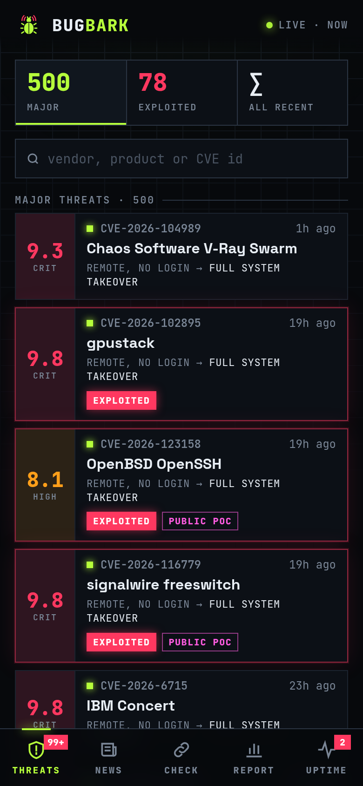
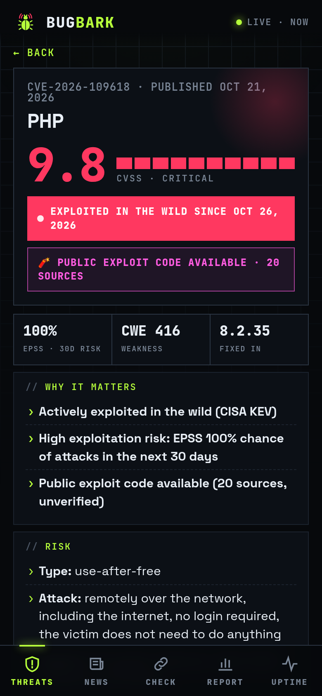
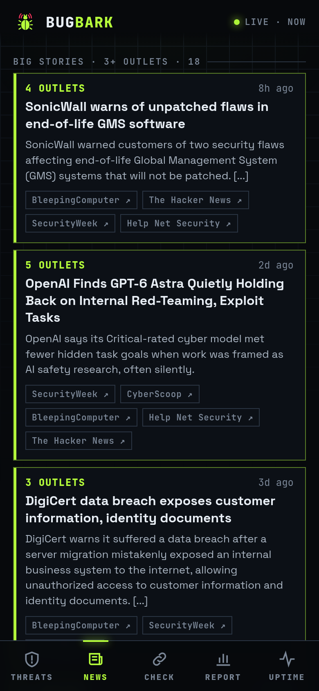
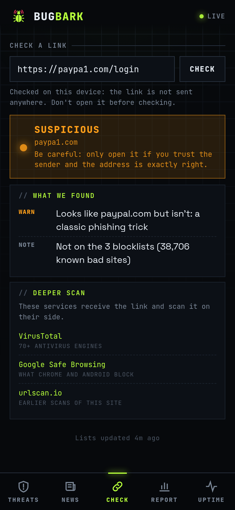
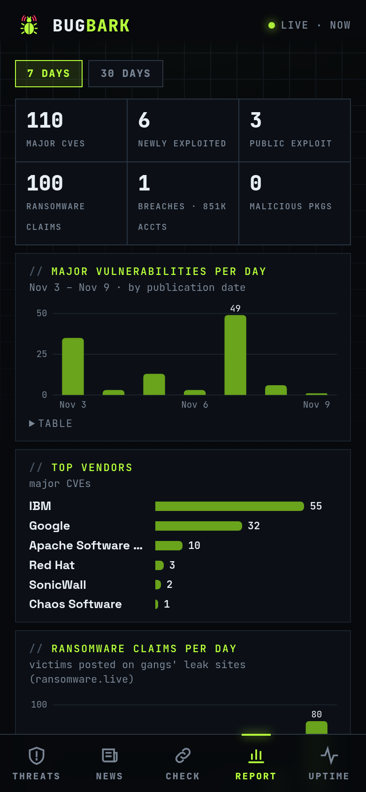
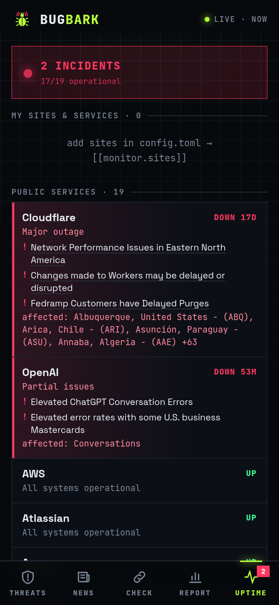

# BugBark

Barks when a bug bites: push notifications to your phone about **major new vulnerabilities** and **outages**, plus a mobile dashboard to see what each one means. Runs for free on GitHub Actions: no server needed.

<table>
  <tr>
    <td></td>
    <td></td>
    <td></td>
  </tr>
  <tr>
    <td align="center">Major threats</td>
    <td align="center">What it means and how to fix it</td>
    <td align="center">Big security stories</td>
  </tr>
  <tr>
    <td></td>
    <td></td>
    <td></td>
  </tr>
  <tr>
    <td align="center">Is this link safe?</td>
    <td align="center">The week in numbers</td>
    <td align="center">What is down</td>
  </tr>
</table>

## What it does

Notifications go through [ntfy](https://ntfy.sh), a free push app for Android and iOS (Telegram works too). Tap one to open the details in the dashboard.

### 🐞 Vulnerabilities

Every 15 minutes BugBark pulls fresh CVEs from the official [CVE list](https://www.cve.org) and [NVD](https://nvd.nist.gov), and alerts only on the ones that matter:

- **exploited** in the wild ([CISA KEV](https://www.cisa.gov/known-exploited-vulnerabilities-catalog), plus [VulnCheck KEV](https://vulncheck.com/kev) with a free token);
- **likely to be exploited** soon ([EPSS](https://www.first.org/epss/) ≥ 50%);
- **critical** (CVSS ≥ 9) at major vendors: Microsoft, Apple, Google, Linux, Cisco, Fortinet, Ivanti, VMware, Oracle and more.

Each alert says in plain words what the risk is ("Remote, no login → full system takeover") and which version fixes it. A batch from one vendor arrives as one message. When **public exploit code** appears on GitHub for a CVE you already know about, you get a follow-up.

### 🌍 What's happening in the world

| | Alerts when | Source |
|---|---|---|
| 📰 **News** | 3+ outlets cover the same story | BleepingComputer, The Hacker News, SecurityWeek, The Record, Krebs and more |
| 💧 **Data breaches** | 500K+ accounts leaked | [Have I Been Pwned](https://haveibeenpwned.com) |
| 💀 **Ransomware** | a gang claims a large company | [ransomware.live](https://www.ransomware.live), sized by [Tranco](https://tranco-list.eu) |
| ☣ **Malicious packages** | a popular npm / PyPI package ships malware | [OpenSSF malicious-packages](https://github.com/ossf/malicious-packages) |
| 🌐 **Internet outages** | a whole country drops offline | [IODA](https://ioda.inetintel.cc.gatech.edu) |

### 🟢 Outages

GitHub, Cloudflare, AWS, Azure, Google Cloud, Slack, Zoom, Discord, OpenAI, Claude, npm, Docker Hub, Atlassian, Vercel, DigitalOcean, Reddit, Dropbox, Twitch and Epic Games, plus your own websites and servers. One alert when something goes down, one when it recovers.

### 🔗 Link checker

The Check tab tells you whether a link is safe to open. It compares it with ~40,000 known malware and phishing sites and looks for tricks: look-alike names (paypa1.com), fake "@" addresses, lookalike letters, shorteners. It runs on your phone, and the link is never sent anywhere. Install the dashboard as an app to share links to it from any app.

### 🔕 Less noise

- **Daily digest** every morning and a **weekly report** on Mondays (also as charts in the Report tab).
- **Quiet hours** 23:00–08:00: only exploited CVEs ring at night, the rest arrive as one "Overnight" summary.
- **Mute** a vendor with one tap. Exploited CVEs still come through.
- **Self-check:** if a source keeps failing for an hour, BugBark tells you.

No dependencies: only the Python standard library.

## Quick start (GitHub Actions, free)

1. **Fork** this repository.
2. **Phone:** install ntfy ([Android](https://play.google.com/store/apps/details?id=io.heckel.ntfy) / [iOS](https://apps.apple.com/app/ntfy/id1625396347)), tap **+** and subscribe to a long random topic name, e.g. `bugbark-7f3k9q2m`. The topic works like a password. Everyone subscribed to it (you, your team) gets the alerts.
3. **Secrets:** in your fork, open *Settings → Secrets and variables → Actions → New repository secret* and add `NTFY_TOPIC` with that topic name.
4. **Pages:** in *Settings → Pages*, set **Source** to **GitHub Actions**.
5. **Run:** in *Actions*, enable workflows, open **Check** and click **Run workflow**.

The first run loads the last day of CVEs (5–10 minutes) and sends a single "BugBark is running" summary instead of a flood. After that it runs every 15 minutes. The dashboard is at `https://<your-username>.github.io/bugbark/`.

Optional secrets:

| Secret | Purpose |
|---|---|
| `NVD_API_KEY` | [Free NVD key](https://nvd.nist.gov/developers/request-an-api-key): faster and more reliable NVD requests. Paste the key shown after you open the activation link from the e-mail |
| `TELEGRAM_TOKEN`, `TELEGRAM_CHAT_ID` | Also send alerts to Telegram |
| `NTFY_TOKEN` | Access token for a protected or self-hosted ntfy server |
| `VULNCHECK_TOKEN` | [Free VulnCheck token](https://vulncheck.com/register): a second list of exploited CVEs, often days ahead of CISA |
| `BUGBARK_TIMEZONE` | Your timezone for the digest, weekly report and quiet hours, e.g. `Europe/Berlin` (default UTC) |

On GitHub Actions the exploit search uses the built-in `GITHUB_TOKEN`; self-hosted, set `GITHUB_TOKEN` to any token for a higher search rate limit.

### Good to know

- **Everything on GitHub Pages is public**: the dashboard, the monitored site list, and the `state` branch where the database is kept between runs. CVE data is public anyway. Don't monitor anything you want to keep private.
- **GitHub starts scheduled runs late under load**, sometimes by 10–30 minutes. That's fine for CVEs but slow for outage alerts. If you need minute-level uptime checks, self-host (below).
- **"Handled" / "Not relevant" marks** on the static dashboard are saved in your browser only.

## Configuration

Edit [`config.toml`](config.toml): CVSS threshold, vendor list, a `watch` list for software you run yourself (alerts start from CVSS 7), instant vs. digest alerts, digest time, quiet hours, muted vendors, breach, ransomware, package and outage thresholds, link lists, news feeds and how many outlets make a story "big", your sites and ports, and status pages. Never put secrets there: they come from environment variables.

## Self-hosting

Run it on any always-on machine (a PC, VPS, Raspberry Pi, or a router that supports containers). Checks run every minute, and the dashboard is live on your network.

```bash
echo "NTFY_TOPIC=bugbark-7f3k9q2m" > .env
docker compose up -d --build
```

Without Docker (Python 3.11+):

```bash
NTFY_TOPIC=bugbark-7f3k9q2m python3 -m bugbark
```

Then open `http://<machine-ip>:8080`. Other modes: `--test-notify` sends a test alert, `--once` runs every check once, `--due` runs only the checks that are due, and `--export DIR` writes the static dashboard.

## License

[MIT](LICENSE)
