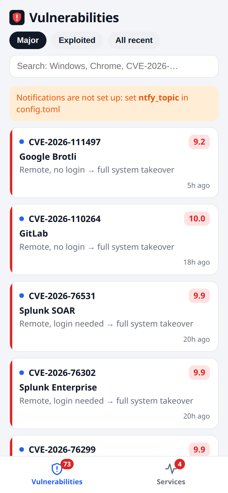
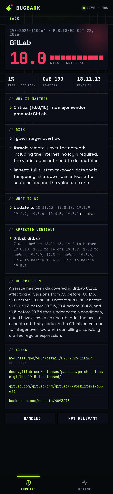
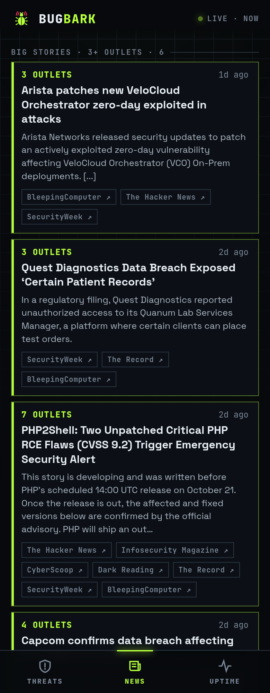
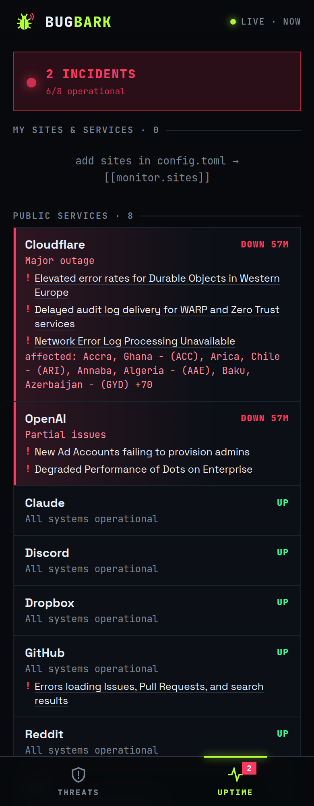

# BugBark

Barks when a bug bites: push notifications to your phone about **major new vulnerabilities** and **outages**, plus a mobile dashboard to see what each one means. Runs for free on GitHub Actions: no server needed.

<p>
  
  
  
  
</p>

## What it does

**Vulnerabilities.** Every 15 minutes it pulls fresh CVEs from the official [CVE list](https://www.cve.org) (minutes after publication) and [NVD](https://nvd.nist.gov), and alerts only on the ones that matter:

- **actively exploited** in the wild ([CISA KEV](https://www.cisa.gov/known-exploited-vulnerabilities-catalog)),
- **likely to be exploited** soon ([EPSS](https://www.first.org/epss/) ≥ 50%),
- **critical** (CVSS ≥ 9) in products of major vendors: Microsoft, Apple, Google, Linux, Cisco, Fortinet, Ivanti, VMware, Oracle, and more (editable list).

Each alert says in plain words what the risk is ("Remote, no login → full system takeover"), why it matters, and which version fixes it. A batch from one vendor (e.g. a Chrome release with 15 critical fixes) arrives as one message.

**Public exploits.** For every major CVE it searches GitHub for proof-of-concept repositories (and reads NVD's exploit references). When exploit code shows up for a CVE you were already told about, you get a follow-up: "🧨 Exploit published". PoCs are listed as unverified: fake ones often carry malware.

**Daily digest.** One morning summary: major CVEs of the last 24 hours, the top threats, the biggest news stories, and what is down. Set `instant = "exploited"` in `config.toml` to get only the urgent alerts instantly and everything else in the digest.

**Security news.** Headlines from BleepingComputer, The Hacker News, SecurityWeek, The Record, Krebs on Security, Dark Reading and others are grouped into stories. When three or more outlets cover the same event (a big breach, a ransomware attack, a mass-exploited bug), you get one alert. Everything else is in the dashboard's News tab and in the daily digest.

**Outages.** Status of GitHub, Cloudflare, Discord, OpenAI, Claude, npm, Reddit and Dropbox, plus your own websites (HTTP) and servers (TCP port). You get one alert when something goes down and one when it recovers.

**Dashboard.** Tap a notification to open the details: risk, affected versions, what to do, and links.

Notifications go through [ntfy](https://ntfy.sh), a free push app for Android and iOS. Telegram is supported too. No dependencies: only the Python standard library.

## Quick start (GitHub Actions, free)

1. **Fork** this repository.
2. **Phone:** install ntfy ([Android](https://play.google.com/store/apps/details?id=io.heckel.ntfy) / [iOS](https://apps.apple.com/app/ntfy/id1625396347)), tap **+** and subscribe to a long random topic name, e.g. `bugbark-7f3k9q2m`. The topic works like a password. Everyone subscribed to it (you, your team) gets the alerts.
3. **Secrets:** in your fork, open *Settings → Secrets and variables → Actions → New repository secret* and add `NTFY_TOPIC` with that topic name.
4. **Pages:** in *Settings → Pages*, set **Source** to **GitHub Actions**.
5. **Run:** in *Actions*, enable workflows, open **Check** and click **Run workflow**.

The first run loads the last day of CVEs (5–10 minutes) and sends a single "BugBark is running" summary instead of a flood. After that it runs every 15 minutes. The dashboard is at `https://<your-username>.github.io/bugbark/`.

Optional secrets:

| Secret | Purpose |
|---|---|
| `NVD_API_KEY` | [Free NVD key](https://nvd.nist.gov/developers/request-an-api-key): faster and more reliable NVD requests. Paste the key shown after you open the activation link from the e-mail |
| `TELEGRAM_TOKEN`, `TELEGRAM_CHAT_ID` | Also send alerts to Telegram |
| `NTFY_TOKEN` | Access token for a protected or self-hosted ntfy server |

On GitHub Actions the exploit search uses the built-in `GITHUB_TOKEN`; self-hosted, set `GITHUB_TOKEN` to any token for a higher search rate limit.

### Good to know

- **Everything on GitHub Pages is public**: the dashboard, the monitored site list, and the `state` branch where the database is kept between runs. CVE data is public anyway. Don't monitor anything you want to keep private.
- **GitHub starts scheduled runs late under load**, sometimes by 10–30 minutes. That's fine for CVEs but slow for outage alerts. If you need minute-level uptime checks, self-host (below).
- **"Handled" / "Not relevant" marks** on the static dashboard are saved in your browser only.

## Configuration

Edit [`config.toml`](config.toml): CVSS threshold, vendor list, a `watch` list for software you run yourself (alerts start from CVSS 7), instant vs. digest alerts, digest time, news feeds and how many outlets make a story "big", your sites and ports, and status pages. Never put secrets there: they come from environment variables.

## Self-hosting

Run it on any always-on machine (a PC, VPS, Raspberry Pi, or a router that supports containers). Checks run every minute, and the dashboard is live on your network.

```bash
echo "NTFY_TOPIC=bugbark-7f3k9q2m" > .env
docker compose up -d --build
```

Without Docker (Python 3.11+):

```bash
NTFY_TOPIC=bugbark-7f3k9q2m python3 -m bugbark
```

Then open `http://<machine-ip>:8080`. Other modes: `--test-notify` sends a test alert, `--once` runs every check once, `--due` runs only the checks that are due, and `--export DIR` writes the static dashboard.

## License

[MIT](LICENSE)
